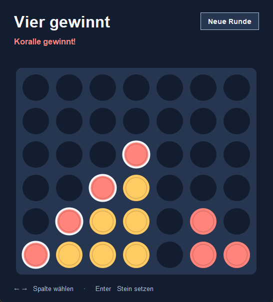

# Vier gewinnt

Zwei Personen, ein Rechner, sieben Spalten. Koralle beginnt. Wer zuerst vier eigene Steine in eine Reihe bringt, gewinnt. Waagerecht, senkrecht und diagonal zählen.



## Spielen

Du brauchst ein **JDK ab Version 17**. Lade das Projekt herunter und entpacke es. Unter Windows startet ein Doppelklick auf **start.cmd** das Spiel.

Auf macOS oder Linux im Projektordner:

```sh
mkdir -p out
javac --release 17 -encoding UTF-8 -d out src/*.java
java -cp out VierGewinnt
```

Klicke auf eine Spalte, um einen Stein fallen zu lassen. Mit den Pfeiltasten kannst du die Spalte wechseln und mit Enter setzen. Ist eine Spalte voll, bleibst du am Zug. **Neue Runde** leert das Brett und Koralle beginnt wieder.

## Wie erkennt das Spiel einen Sieg?

Nach jedem Zug prüft [Game.java](src/Game.java) die Linien durch den gerade gesetzten Stein. Dafür zählt das Spiel die gleichfarbigen Nachbarn in beide Richtungen. Liegt der neue Stein etwa zwischen zwei links und einem rechts, sind es zusammen vier. Die Oberfläche in [VierGewinnt.java](src/VierGewinnt.java) zeichnet das Brett mit Swing, animiert den Zug und hebt die Gewinnreihe hervor.

## Regeln testen

Diese Befehle im Projektordner ausführen:

```sh
javac --release 17 -encoding UTF-8 -d out src/Game.java tests/GameTest.java
java -cp out GameTest
```

Die Tests spielen konkrete Zugfolgen durch, darunter beide Diagonalen, eine volle Spalte und ein Unentschieden nach 42 Zügen.
